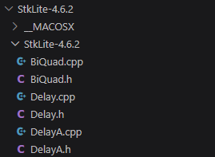
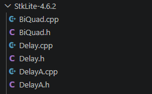
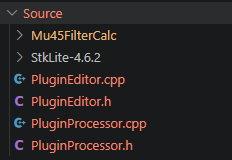
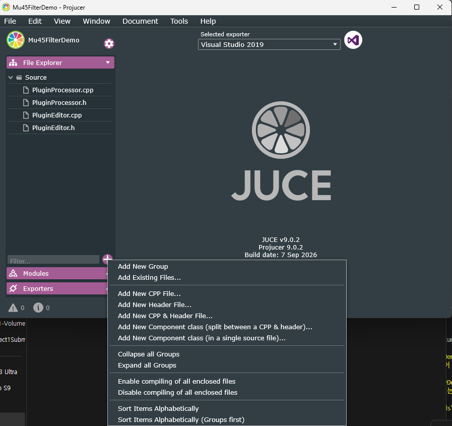

# Making a simple Low Pass Filter

## 0. Requirements
1. Make a new AudioPlugin effect using Projucer. Name it `Mu45FilterDemo`.
2. From Canvas/Filtes/Code, download `StkLite-4.6.2.zip` and `Mu45FilterCalc.zip`.

> the current version of Stk, stk5.0.1, will make a tiny errors without some configurations.\ We are using the previous version provided in Canvas for now.

### Q. What are these .zip files? What do they do?
They are sets of different codes that JUCE does not provide.\
We call these *external library*. \
For this exercise, we learn how to use external libraries in JUCE.\

### So, this handout can be divided into 3 parts:
  [1. Writing a basic JUCE code](#1-writing-a-basic-juce-code)\
  [2. **Adding External Library** to the JUCE project](#2-adding-external-library-to-the-juce-project)\
  [3. **Adding filters** to the code](#3-adding-filters-to-the-code)\

## 1. Writing a basic JUCE code 
1. Configure `PluginProcessor.h`.
   - define `calcAlgorithmParams()` method.
   - Create two AudioParameterFloats for *cutoff frequency* (`mFilterFcParam`) and *Q* (`mFilterQParam`).
    
    **📄PluginProcessor.h**
    ``` c++
    private:
        void calcAlgorithmParams();
        juce::AudioParameterFloat *mFilterFcParam;
        juce::AudioParameterFloat *mFilterQParam;
    ```

2. Write a code in `PluginProcessor.cpp`.
   - instantiate AudioParameters in the constructor.
  
   **📄PluginProcessor.cpp**
   ``` c++
   Mu45FilterDemoAudioProcessor::Mu45FilterDemoAudioProcessor()
   {
    // Filter CutOff parameter
    addParameter(mFilterFcParam = new juce::AudioParameterFloat("Filter Cutoff (Hz) ", // parameterID,
                                                                "FiltFc",              // parameterName,
                                                                40.0f,                 // minValue,
                                                                10000.0f,              // maxValue,
                                                                500.0f));              // defaultValue
    // Filter Q parameter
    addParameter(mFilterQParam = new juce::AudioParameterFloat("Filter Q", // parameterID,
                                                               "FiltQ",    // parameterName,
                                                               1.0f,       // minValue,
                                                               10.0f,      // maxValue,
                                                               3.0f));     // defaultValue
    }
   ```

3. Configure `PluginEditor.h`.
   - Add `juce::Slider::Listener` class and its `sliderValueChanged()` function
   - add 2 slider variables for cuttoff frequency(`mFilterFcSlider`) and Q (`mFilterQSlider`).
  
    **📄PluginEditor.h**
    ``` c++
    class Mu45FilterDemoAudioProcessorEditor : public juce::AudioProcessorEditor, public juce::Slider::Listener
    {
    public:
    Mu45FilterDemoAudioProcessorEditor(Mu45FilterDemoAudioProcessor &);
    ~Mu45FilterDemoAudioProcessorEditor() override;

    //==============================================================================
    void paint(juce::Graphics &) override;
    void resized() override;

    // newly added functions for Mu45
    void sliderValueChanged(juce::Slider *slider) override;

    private:
    // This reference is provided as a quick way for your editor to
    // access the processor object that created it.
    Mu45FilterDemoAudioProcessor &audioProcessor;
    juce::Slider mFilterFcSlider;
    juce::Slider mFilterQSlider;
    JUCE_DECLARE_NON_COPYABLE_WITH_LEAK_DETECTOR(Mu45FilterDemoAudioProcessorEditor)
    };
    ```


4. Write a code in `PluginEditor.cpp`. 
   - set attributes of the sliders in the constructor.
  
    **📄PluginEditor.cpp**
    ``` c++
    Mu45FilterDemoAudioProcessorEditor::Mu45FilterDemoAudioProcessorEditor (Mu45FilterDemoAudioProcessor& p)
        : AudioProcessorEditor (&p), audioProcessor (p)
    {
        // Make sure that before the constructor has finished, you've set the
        // editor's size to whatever you need it to be.
        setSize (400, 300);

        auto &params = processor.getParameters();

        // Cuttoff Freq Slider
        juce::AudioParameterFloat *audioParam = (juce::AudioParameterFloat *)params.getUnchecked(0);
        mFilterFcSlider.setBounds(0, 0, 100, 160);
        mFilterFcSlider.setSliderStyle(juce::Slider::SliderStyle::LinearVertical);
        mFilterFcSlider.setTextBoxStyle(juce::Slider::TextBoxBelow, false, 70, 20);
        mFilterFcSlider.setRange(audioParam->range.start, audioParam->range.end);
        mFilterFcSlider.setValue(*audioParam);
        mFilterFcSlider.addListener(this);
        addAndMakeVisible(mFilterFcSlider);
        
        // Q slider
        audioParam = (juce::AudioParameterFloat *)params.getUnchecked(1);
        mFilterQSlider.setBounds(0, 190, 100, 80);
        mFilterQSlider.setSliderStyle(juce::Slider::SliderStyle::RotaryVerticalDrag);
        // mFilterQSlider.setTextBoxStyle(juce::Slider::NoTextBox, true, 0, 0);
        mFilterQSlider.setTextBoxStyle(juce::Slider::TextBoxBelow, false, 70, 20);
        mFilterQSlider.setRange(audioParam->range.start, audioParam->range.end);
        mFilterQSlider.setValue(*audioParam);
        mFilterQSlider.addListener(this);
        addAndMakeVisible(mFilterQSlider);
    }
    ```

   - implement `sliderValueChanged( )` function.
  
    **📄PluginEditor.cpp**
    ``` c++
    void Mu45FilterDemoAudioProcessorEditor::sliderValueChanged(juce::Slider *slider)
    {
        auto &params = processor.getParameters();

        if (slider == &mFilterFcSlider)
        {
            juce::AudioParameterFloat *audioParam =
                (juce::AudioParameterFloat *)params.getUnchecked(0);
            *audioParam = mFilterFcSlider.getValue(); // set the AudioParameter
            DBG("Fc Slider Changed");
        }
        else if (slider == &mFilterQSlider)
        {
            juce::AudioParameterFloat *audioParam =
                (juce::AudioParameterFloat *)params.getUnchecked(1);
            *audioParam = mFilterQSlider.getValue(); // set the param
            DBG("Q Slider Changed");
        };
    }
    ```

> ### 🛠️ Build and Check time!
> Open the GUI and check if there is one vertical slider and one rotary knob.

## 2. Adding External Library to the JUCE project
We will now add `StkLite-4.6.2` and `Mu45FilterCalc` in our project.\
First, unzip them and make sure the file structure aligns to what we want.\

1. How does unzipped `StkLite-4.6.2` look like?

We want `.cpp` and `.h` files directly under `StkLite-4.6.2` folder.\
However, this has another folder named `StkLite-4.6.2` inside the folder with the same name.\
Make the file structure be like this:

Without any subfolders, let `.cpp` and `.h` files directly under `StkLite-4.6.2` folder.\

Please do the same with `Mu45FilterCalc`.

2. Copy `StkLite-4.6.2` and `Mu45FilterCalc` folders into your `Source` folder in your project. 
Your `Source` folder should be look like this:


3. Go to the Projucer app and open the project. On the left tab, click File Explorer and click '+'. Then, select `Add Existing Files...`


4. Select two folders we just added, and select `Open`.


5. **Save** and Build!

> ### 🛠️ Build and Check time!
> Make sure it compiles without errors!


## 3. Adding filters to the code
Now, we are going to add and make filters with added external libraries.

1. Edit `PluginProcessor.h`.
    - Include `Mu45FilterCalc` and `Biquad` (from Stk) headers at the top of the code.\
    - Add a biquad filter for each channel.\
    - Add other member variables (ex: `mFs` for storing sampling rate)\

    **📄PluginProcessor.h** 
    ``` c++
    #pragma once

    #include <JuceHeader.h>
    #include "Mu45FilterCalc/Mu45FilterCalc.h"
    #include "StkLite-4.6.2/BiQuad.h"
    ...
    private:
        //==============================================================================
        JUCE_DECLARE_NON_COPYABLE_WITH_LEAK_DETECTOR(Mu45FilterDemoAudioProcessor)
        void calcAlgorithmParams();
        juce::AudioParameterFloat *mFilterFcParam;
        juce::AudioParameterFloat *mFilterQParam;

        // Mu45: Objects we need
        stk::BiQuad mFilterL, mFilterR; // The filters
        float mFs; //Sampling rate

    ```

2. Edit `processBlock()` method in `PluginProcessor.cpp`.
    - modify the `processBlock()` method to call `calcAlgorithmParams()`.
    - make it process audio chennels through the filters by using the filters' `tick()` method.
    **📄PluginProcessor.cpp**
   ``` c++
    void Mu45FilterDemoAudioProcessor::processBlock(juce::AudioBuffer<float> &buffer, juce::MidiBuffer &midiMessages)
    {
        // JUCE book - keeping to make sure there's no bad data in the output buffers
        juce::ScopedNoDenormals noDenormals;
        auto totalNumInputChannels = getTotalNumInputChannels();
        auto totalNumOutputChannels = getTotalNumOutputChannels();
        for (auto i = totalNumInputChannels; i < totalNumOutputChannels; ++i)
        {
            buffer.clear(i, 0, buffer.getNumSamples());
        }
        // Update the algorithm params
        calcAlgorithmParams();
        // Get the left and right audio buffers
        auto *channelDataLeft = buffer.getWritePointer(0);
        auto *channelDataRight = buffer.getWritePointer(1);
        // The inner loop! Step through each sample in the audio buffer
        for (int samp = 0; samp < buffer.getNumSamples(); samp++)
        {
            // Process each audio sample
            channelDataLeft[samp] = mFilterL.tick(channelDataLeft[samp]);
            channelDataRight[samp] = mFilterR.tick(channelDataRight[samp]);
        }
    }
   ``` 

3. Edit `prepareToPlay()` method in `PluginProcessor.cpp`.
   - We are storing current audio sampling rate here.
    **📄PluginProcessor.cpp**
   ``` c++
    void Mu45FilterDemoAudioProcessor::prepareToPlay(double sampleRate, int samplesPerBlock)
    {
        // Use this method as the place to do any pre-playback
        // initialisation that you need..
        mFs = sampleRate;
    }
   ``` 


4. Implement code in `calcAlgorithmParams()` method in `PluginProcessor.cpp`.
   - We will use `Mu45FilterCalc::calcCoeffsLPF()` to calculate 5 biquad coefficients for a resonant low-pass filter with the cutoff frequency and Q from the parameters.
   - We will use `setCoefficients()` of `BiQuad` class to set the coefficients of the filters.
    **📄PluginProcessor.cpp**
   ``` c++
    void Mu45FilterDemoAudioProcessor::calcAlgorithmParams()
    {
        // Get the user parameter values
        float fc = mFilterFcParam->get();
        float Q = mFilterQParam->get();
        // Calculate filter coefficients
        float coeffs[5]; // an array of 5 floats for filter coeffs: [b0, b1, b2, a1, a2]
        Mu45FilterCalc::calcCoeffsLPF(coeffs, fc, Q, mFs);
        // Set the coefficients for each filter
        mFilterL.setCoefficients(coeffs[0], coeffs[1], coeffs[2], coeffs[3], coeffs[4]);
        mFilterR.setCoefficients(coeffs[0], coeffs[1], coeffs[2], coeffs[3], coeffs[4]);
        // DBG("Fc = "<<fc); // For debugging
    }
   ``` 

> ### 🛠️ Build and Check time!
> Change the slider and knob values and see/hear the difference!